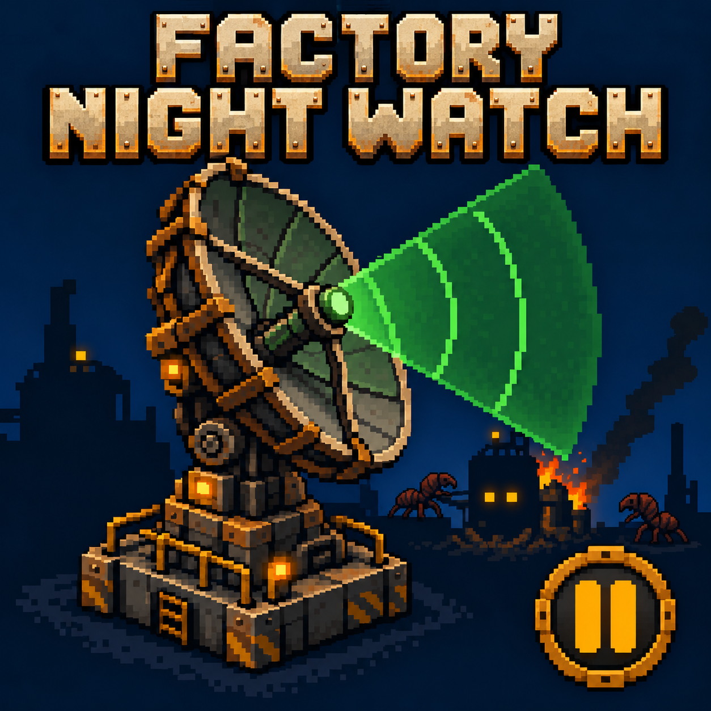
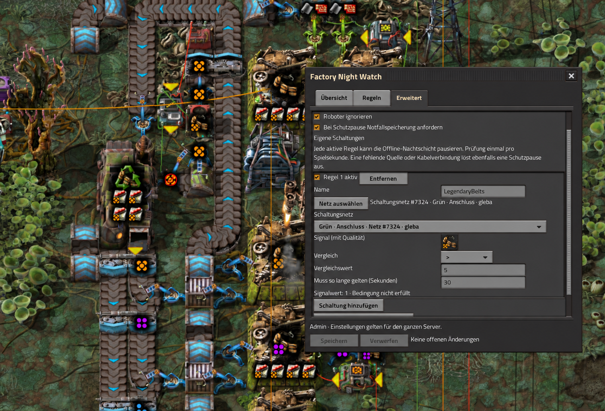
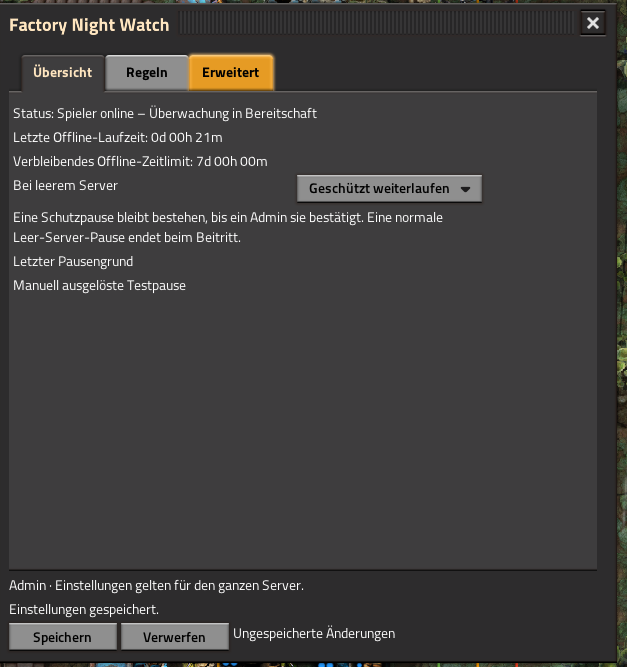
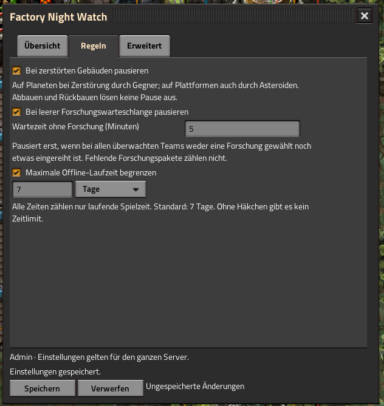

# Factory Night Watch



Keep your cooperative Factorio factory running while everyone is offline, with
configurable safety pauses when something needs attention.

**Version 0.3.10 · Factorio 2.1 (base >= 2.1.23) · Space Age supported · English / Deutsch**

[Download from the Factorio Mod Portal](https://mods.factorio.com/mod/factory-night-watch)
— 0.3.10 published on 2026-10-31.

[Deutsche Anleitung](docs/README.de.md) · [Validation](docs/TESTS.txt) ·
[Changelog](mod/changelog.txt)

## Screenshots

### Circuit conditions



### Overview and protection rules





The interface is available in English and German; these captures show German.
The circuit screenshot is cosmetically retouched to show the saved footer state.
Overview and Rules were captured before the save-status fix in 0.3.6.

## Features

- Pause on structure destruction, an empty research queue, or an offline time limit.
- Default time limit: 7 simulation days; configurable or unlimited.
- Optional named circuit conditions: select a connected circuit entity and its exact network/connector,
  signal and quality, comparison, threshold and continuous delay.
- Live signal values and network IDs; offline safety pause if an enabled rule loses its source entity or connection.
- Source coordinates stay saved for alarm-location viewing even after the source entity is removed.
- Bottom-right native shortcut with Overview, Rules and Advanced tabs.
- Admin-only changes, save/discard drafts and confirmation before a test pause.
- Persistent safety alarms, offline timers and circuit rules across save/reload.
- Jump to the alarm location in remote view while keeping the safety pause active.
- Three rotating emergency saves; synthetic sandbox surfaces are excluded.

Protection pauses stop the whole simulation and require admin acknowledgement.
They do not automatically roll back damage. Ordinary empty-server pauses resume
when someone joins. AFK players still count as online.

## Install

Install **Factory Night Watch** through Factorio’s mod manager or download it
from the [Mod Portal](https://mods.factorio.com/mod/factory-night-watch).
Use the same version on the server and all clients.

To build a package from this repository instead, use Python 3 (standard library only):

```sh
python3 tools/build.py
```

Copy `dist/factory-night-watch_0.3.10.zip` into each client's Factorio `mods`
directory without extracting it. Remove older ZIP versions and restart Factorio.
All clients and the server need the same version. The published 0.3.10 is available
on the Factorio Mod Portal.

Open the bottom-right radar shortcut, or use `/fnw-gui`. `/fnw-status` is readable
by everyone; `/fnw-resume`, `/fnw-test-pause` and `/fnw-set` require an admin.

An optional Docker installer is generated as `dist/install-factory-night-watch.sh`.
It is specific to a `factoriotools/factorio` layout with container name `factorio`,
`compose.yaml`, a `/factorio` data bind mount and UID/GID 845. Read the script before
running it. It briefly stops Factorio, creates a rollback snapshot and changes
`auto_pause` to false. Other layouts can install the ZIP manually, with server
`auto_pause=false` for protected offline running.

## Updates directly from GitHub

[Server setup and update commands](docs/UPDATES.md). After the one-time GitHub CLI
login and command setup, run `~/.local/bin/factorio-mod-update` as your normal
server user. The updater downloads a fixed commit, builds the ZIP and invokes
the existing installer using sudo. It creates a rollback snapshot before changing
the installation. An unchanged installed commit does not restart Factorio.
This is on-demand deployment; it does not run unattended or update Factorio itself.
All clients still need the same mod version. `--build-only DIRECTORY` builds
files without touching a server.

## Circuit conditions

Under **Advanced**, add a condition and select a network by dragging a box around connected circuit entities. The same network is listed
once. A single network is selected directly; multiple networks require an explicit
choice including red/green and input/output. Then choose a signal, an operator and a
threshold. Set how many consecutive simulation seconds it must remain true.
Save the draft to activate it. Put complex AND/OR logic in ordinary combinators.

Rules are sampled once per simulation second. An absent signal in an intact
network reads zero. A missing source entity or selected connector network triggers a safety pause while
offline. Online, rules only show their live state. Multiple enabled rules act
as OR: any one can pause the world. Clear the cause before acknowledging.

## Additional building exclusions

In **Advanced → Additional building exclusions → Add building exclusion**, select
an entity using the native picker, then **Save**. Add/remove rows for individual
building prototypes, such as a transport belt or gun turret. Each entry applies
to that exact variant in every quality on all monitored surfaces. Other variants
of the same class remain protected. The existing wall/gate and robot switches
continue to apply independently.

The list affects structure-loss alarms only. Area exclusions can be used alongside
it; research, offline limits and explicit circuit rules (including missing-source
fail-safes) stay active. Up to 128 entries are supported; duplicates are merged
on save. Missing prototypes from removed mods remain listed by internal name and
can be removed; they do not block saving other settings. The list is stored in
the save and uses the same Save/Discard and multi-admin conflict checks.

## Excluded areas

In **Advanced → Excluded areas → Draw excluded area**, drag a rectangle on the
planet or platform, give it a name and **Save**. Empty land can be selected too;
new buildings placed there are automatically covered. Up to 64 rectangles can be
enabled/disabled, removed or inspected using **View area**. Viewing opens remote
view with a persistent outline in world and map views. A small panel shows whether
there are unsaved changes and offers **Back to excluded areas** or **Save and return**
for all pending settings. Viewing alone never saves. Returning ends the preview
and removes both outlines; zooming does not. The pause is not released.

Exclusions suppress **structure-loss alarms only**, for every building type whose
centre lies inside the rectangle. Top/left edges are included; bottom/right edges
are excluded. Overlapping rectangles form a union. Each area belongs to its exact
surface: other planets/platforms at the same coordinates are unaffected. Renaming
a surface keeps its areas; deleting it does not transfer them to a replacement.
Explicit circuit conditions (including missing-source fail-safes), research and
time-limit alarms remain active. Changes use Save/Discard and admin conflict
protection, and are stored in the save.

## Development

```sh
python3 tests/run.py
python3 -m unittest discover -s tests -p 'test_*.py'
python3 tools/build.py
```

The first command runs GUI/presence regression checks with Lua mocks. Install Lua 5.4 or
its shared library. The build validates metadata, matching locale keys, archive
integrity, embedded installer Python and shell syntax when Bash is available.

Real engine integration tests require a local **Factorio headless 2.1.23** with
Space Age data. They create their own maps and test-only mod copy:

```sh
FACTORIO_BIN=/path/to/factorio/bin/x64/factorio python3 tests/integration.py
FACTORIO_BIN=/path/to/factorio/bin/x64/factorio python3 tests/integration.py --base-only
```

Space Age tests use 34997/UDP and 27995/TCP; base-only tests use 34998/UDP
and 27996/TCP. These ports must be free; all listeners bind to localhost.
Generated test data goes into ignored `build/integration/`. Never point tests at
a production installation or save. The test-only bridge is excluded from builds.
See [CONTRIBUTING.md](CONTRIBUTING.md) for the contribution workflow.

## Development disclosure

Developed with AI-assisted coding tools. Maintained by **dermalla**. The installed
mod runs normal Factorio scripts and does not use an AI service during play.
AI tools were used for code generation, documentation and review.

Portal text sources: [description](docs/mod-portal/description.md) and
[FAQ](docs/mod-portal/faq.md). See [release notes](docs/releases/0.3.10.md) for the
published version and validation record.

## Release readiness

Three independent pre-release reviews covered runtime behavior, GUI/state handling,
and packaging/installer recovery. See [the 0.3.4 review record](docs/RELEASE_REVIEW.md)
and [validation details](docs/TESTS.txt). On 2026-10-29, the maintainer confirmed
the proposed 0.3.10 live-client/server checklist passes, including area preview,
building exclusions, alarm behavior and persistence. Automated 0.3.10 validation
includes 186 Lua GUI/logic checks, 60 base-only engine checks and 22 installer/updater tests.
No new automated DLC integration run is claimed.
Backups remain necessary. There is no separate platform-hub health rule.

Licensed under the [MIT License](LICENSE). Copyright (c) 2026 dermalla.
Available on the [Factorio Mod Portal](https://mods.factorio.com/mod/factory-night-watch).
